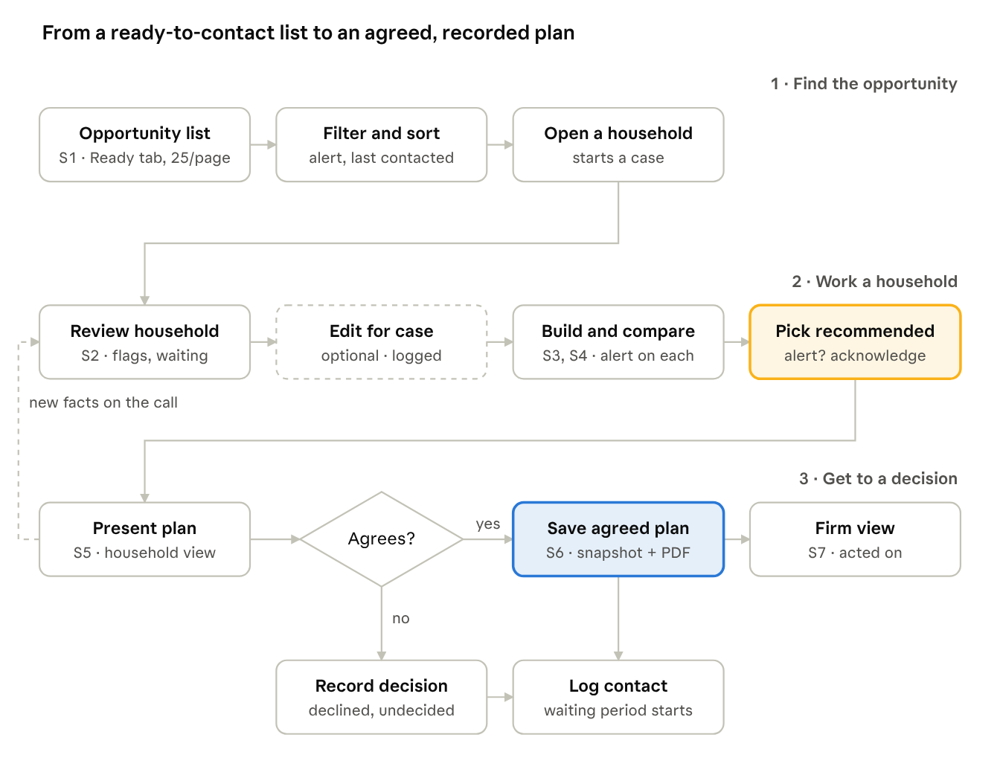

# Debt Free Tool — Requirements for Design (v1)

Source of truth for the prototype. Exported from the requirements doc on 18 Nov 2026. If code and this file disagree, this file wins.

Design the screens that take a financial advisor from "which households should I talk to?" to "here's the plan my household agreed to", and give managers a view of the opportunity and the results.

## Problem and goals

Today advisors only look at a household's debt before a booked call, copy its debts by hand into their own Excel calculator, and walk the household through a spreadsheet it struggles to follow. Nobody else can see what was proposed or agreed.

**Goal:** one shared tool every advisor uses to find households to help, build a plan live with them, and record the plan they agree to. The outcome the firm wants is more households agreeing to a plan that makes them debt free sooner.

| Measure | Definition |
| --- | --- |
| Adoption | Share of advisors casing households in the tool instead of spreadsheets |
| Acted on | Households that **agreed** a plan. Applications and funding happen outside the tool |
| Household value | Months to debt free saved by agreed plans vs the current path |
| Speed | Median time from opening a household to a finalised plan |

## Users and what they're trying to do

The advisor is the only person who works in the tool. The household sees it on a shared screen or across a desk and takes home a one-page summary. "Client" and "household" mean the same thing.

| User | Context | Trying to do | Design for |
| --- | --- | --- | --- |
| **Financial advisor** (primary) | A few hundred households. A servicing call with each every couple of months; prepares ("cases") 1 to 2 weeks before | Find who to help, build the plan that makes them debt free soonest, change it live as the household adds facts (bonus, raise, savings, a corrected value), record what they agreed | Speed, trust in the numbers, working live in front of a household |
| **Junior analyst** | Supports an advisor (teams of 2 to 3) | See what was cased, proposed and agreed | Read-only clarity |
| **Branch manager, chief lending officer** | Oversee advisors | See the opportunity, who was cased, proposed, agreed; track advisor performance | Rollups with drill-down to one household |
| **Household** (viewer) | On the call or in the room | How soon they're debt free, what they save, what they pay each month | Plain words, no spreadsheet |

**Households care most about** how soon they're debt free, then monthly cash freed. **They push back on** a plan that sharply raises the monthly payment, and on being approached about their debts too often.

## Screens to design

Seven screens cover the three journeys and the firm view. S3 to S5 are used live with a household and must update within about 1 second of any change. On S2 to S5 the main actions sit in an action bar fixed to the bottom of the screen, always visible. Present appears only once a plan is marked recommended, never on S2.

| # | Screen | Must show | Key actions |
| --- | --- | --- | --- |
| S1 | Opportunity list (J1) | Tabs: Ready to contact (default), Waiting, Progress check due. 25 households a page, ranked by months saved. Per row: months and interest saved, best plan type, the nightly plan's payment alert, eligible products, data flags, case status, last contacted date, ready date | Switch tab, filter, sort (incl. last contacted), page, open a household |
| S2 | Household overview (J2) | A fixed summary header: comfort zone, household FICO, income, outreach status, and what the plan in play saves vs today (months and interest; the recommended plan once marked, else the nightly best, labelled). Below it, tabs that each show only their own data: Debts (default; flags and excluded debts), Members, Properties, Contact history, Case history. A banner if the household is in a waiting period | Edit a value for this case, report a data issue; action bar: Start or Continue case |
| S3 | Scenario workspace (J2) | One table: each plan is a column, each attribute a row (source label, debt-free in, months saved, total interest, interest saved, monthly payment, payment alert, loan and security). Columns: Current path (pinned first, highlighted as today's baseline), Nightly best (the pipeline's plan, as is), Built-in (avalanche, snowball, one per eligible product), Built by you (the advisor's own). A Suggested badge marks the tool's current suggestion. Collapsible rows list every debt with its debt-free date under each plan. Sticky first column; scrolls sideways when there are many plans | Build or edit: product, term, amount, debts to move, custom loan, extra payments; tick up to 4 plans; action bar: New scenario, Compare |
| S4 | Compare and schedule (J2) | Current path as the first, highlighted card, then up to 4 plan cards side by side with source labels; the tool's suggestion and why it won; month-by-month schedule and payoff order for the selected card | Click a card to select it; action bar: Mark as recommended (acknowledge any alert, give a reason if it differs from the suggestion), then Present |
| S5 | Present mode (J3) | Household-friendly, opened only after a plan is recommended. Names the plan offered. Today vs the recommended plan side by side, other compared plans in grey: debt free by, months sooner, total interest, interest saved, monthly payment, payoff order. Plain-words advantages and things to know (from the fixed list in rule 9). The month-by-month schedule to walk through, grouped by year with months on expand | Expand a year; switch to a grey plan live; action bar: Agreed, Not now, Needs time |
| S6 | Decision and one-pager (J3) | Agreed, declined or undecided; frozen snapshot; the household's PDF (page 1: one-page summary with advantages and things to know; then the month-by-month schedule), offered once they agree | Confirm, download or send PDF; contact is logged |
| S7 | Firm view | Opportunity (ready now vs waiting) and funnel (opportunity, cased, proposed, agreed) by advisor and branch; months and interest saved | Filter, drill to a household's history |

## User flows

1. **Find the opportunity:** Opportunity list (S1, Ready tab, 25 a page) → filter and sort (payment alert, last contacted) → open a household (starts a case).
2. **Work a household:** review household (S2: flags, waiting banner) → optional case-only edits (logged) → build and compare scenarios (S3, S4: payment alert on each) → pick the recommended plan (acknowledge any alert).
3. **Get to a decision:** present the plan (S5) → household agrees? Yes: save the agreed plan (S6: frozen snapshot and one-page PDF) and it counts in the firm view (S7). No: record declined or undecided. Either way, log the contact; the household's waiting period starts.
- New facts on the call (S5) send the advisor back to S2 to rework the plan.

## Business rules

The advisor decides the plan; the tool suggests and alerts but never chooses. The referral the firm earns on loans never affects a ranking or a suggestion.

1. **Monthly maths:** add a month's interest (balance × APR ÷ 12) to each debt, pay each debt's current payment, then put what's left of the budget on the target debt. Every plan keeps paying at least today's total; a paid-off debt's payment moves to the next target.
2. **Strategies:** avalanche = highest rate first; snowball = smallest balance first; current path = no rollover.
3. **Eligibility:** FastApp needs the lender's pre-approval and a comfort zone (max $50k / $150k / $300k for zones 1 / 2 / 3). HELOAN Yellow: FICO 640+, not TX, a property with a first mortgage. HELOAN Pink: FICO 680+, not TX, VT or IA. Never a property with a reverse mortgage.
4. **Home equity size:** value × max CLTV for the FICO band − mortgage on that property, capped at the product's max. An existing home equity loan must be paid off by the new one.
5. **What a loan pays off:** unsecured debts above the loan's rate, highest first, each in full, up to the limit. It must reach the product minimum and lower the blended rate. The advisor can change the selection.
6. **Ranking and suggestion:** most months to debt free saved vs the current path. Ties within 1 month go to less interest, then lower contractual payment, then less risk (no loan, then unsecured, then secured on the home). The nightly best plan is shown as is. If the current path never pays off, months saved and interest saved both show "Not comparable" (tooltip: "Today's payments never clear these debts. With the best plan: debt free in [time]."), and the household ranks first. The Suggested badge in a case can move to an advisor-built plan; the Nightly best label stays on the pipeline's plan.
7. **Payment alert:** every plan, including the nightly best, is compared with what the household pays today (after the advisor's corrections; recurring extras count, one-offs don't). Over +10% = amber, over +25% = red. Alerts never hide or block a plan; recommending one with an alert needs an acknowledgement and a reason. Shown as a small amber or red dot, with the dollar and % change in a tooltip.
8. **Debt free** = every valid debt paid off, mortgage included.

**9. Advantages and things to know (present mode and PDF).** Built only from the plan's own numbers, never free text:

- **Advantages:** debt free [time] sooner; [amount] less interest; monthly payment [amount] lower (when it is); [N] debts become [M].
- **Things to know:** the plan only works if you keep paying today's total each month as debts clear; monthly payment [amount] higher (amber or red alert); the new loan is secured on your home, which is at risk if payments are missed; a new loan needs a credit application; the loan runs [N] years; figures are estimated (default FICO); [debt] is not included in this plan.

### Outreach waiting periods

| Last offer | No proactive offer for | Then |
| --- | --- | --- |
| Presented, declined or undecided | 90 days | Ready |
| Agreed, no new loan | 90 days | Progress check due, not a new offer |
| Agreed with a new loan | 12 months | Ready |
| Household request, or servicing call with no offer | None | Date still recorded |

Waiting periods limit outreach only: a household's request or a booked servicing call is never blocked. Contacting inside a period needs a logged reason. Overlapping offers use the latest end date.

### Worked example: H01, Raj and Anita Patel

Michigan, comfort zone 2, not pre-approved for FastApp. FICO 720 (Anita has no score). Home $450,000, mortgage $280,000 at 6.25%. Other debts: SoFi personal loan $15,000 at 13%, Chase card $12,000 at 24.99%, Citi card $8,000 at 21.5%, Toyota auto $22,000 at 6.9%. Today's payments: $3,620 a month.

- **Eligibility:** Yellow at FICO 720 allows 80% CLTV: $360,000 − $280,000 = $80,000. Pink allows 90%: $125,000.
- **Loan sizing:** Yellow at 7.875% takes Chase, Citi and SoFi = **$35,000** (above the $25,000 minimum). Toyota at 6.9% is cheaper, so it stays.

| Scenario | Debt free in | Total interest | Months saved | Payment alert |
| --- | --- | --- | --- | --- |
| Current path | 240 months | $230,358 | — | — |
| Avalanche | 134 months | $145,717 | 106 | None |
| Yellow 10-yr $35,000, then avalanche | 129 months | $127,511 | 111 | None |
| **Yellow 15-yr $35,000, then avalanche** | 129 months | $127,511 | 111 | None |

**Suggestion: Yellow 15-year.** It beats avalanche by 5 months and about $18,200, so the loan wins on merit, not on a tie. The 10- and 15-year tie, and the 15-year has the lower contractual payment ($332 vs $422). S4 says: "5 months sooner and $18,200 less interest than paying smarter without a loan. Secured on your home." H01 agreed on 4 Sep 2026, so it sits in Waiting until 4 Sep 2027.

**Payment alert example: H11.** Its nightly best plan, FastApp 1-year, takes the payment from $1,562 to $4,548 a month (+191%, red). It shows as is with the alert; the advisor picks FastApp 3-year instead, within 10% of today.

*Simplified maths: fixed payments, no loan fees, interest monthly. Figures are illustrative.*

## Missing data and error states

Never block the advisor. Flag the problem where it changes the numbers, apply the agreed default, and let the advisor override it for this case only. Overrides show the original value beside the new one, are logged, and never write back to the source. About 10% of records have issues like these.

| Issue (example) | Rule | What the screens show |
| --- | --- | --- |
| No FICO for anyone (H03, H11) | Use 740 | S1 flag; S2 flag beside FICO; home equity offers and the one-pager say "estimated" |
| One member has no FICO (H01) | Lowest score that exists | S2 shows whose score is used |
| $0 monthly payment (H07 reverse mortgage, H10 student loan) | Excluded from every plan | Greyed out, "not included in plans"; listed on the one-pager |
| Payment below monthly interest (H07 card) | Included | "Never pays off" warning on the debt; current path shows "never"; months saved and interest saved show "Not comparable" (tooltip: today's payments never clear these debts; with the best plan, debt free in 8 yrs 10 mos); advisor can edit |
| 0% rate (H08 card) | Included | Prompt to confirm or edit the rate |
| Duplicate-looking debts (H11) | Both kept | Both marked "possible duplicate"; advisor can exclude one |
| Stale property value (H09, 1998) | Used as is | Value date in red; advisor can edit the value |
| Mortgage not linked to a property (H15) | No home equity offer | Prompt to link it in the case |
| No comfort zone (H16) | Not FastApp-eligible | Explains why FastApp is missing; advisor can set it |
| Implausible or missing income (H08, H10) | Never used in a rule | Shown on S2 only |

| Screen | State | What to show |
| --- | --- | --- |
| S1 | Nothing ready to contact | "No households are ready for outreach", the next ready date, a link to Waiting |
| S1 | Nothing to gain (H12: a 3.1% mortgage only) | "No action needed", ranked last |
| S1, S2 | Pre-approved, no viable offer (H04: $8,600 of cards, below FastApp's $10,000 minimum) | The reason in one line |
| S1 | Never contacted | "Not contacted yet"; sorts as the oldest contact |
| S2 | Household in a waiting period | Banner with last offer, outcome and ready date; casing allowed; contacting asks for a reason |
| S3 | No eligible products | Avalanche and snowball only, with why each product is unavailable |
| S3 | Custom or edited loan doesn't save money or is below the minimum | Allowed, marked "won't save money" or "below minimum" |
| S3, S4 | Plan never pays off | "Never debt free at these payments" |
| S4 | Tie between plans | Which tie-break decided it, in plain words |
| S5 | Data flags active | Kept advisor-only; household notes ("estimated", "not included") still show |
| S6 | Data reloads after agreement | Snapshot unchanged; S2 notes the data has changed since |
| Any | Recalculation fails or data won't load | Keep the last good result, mark it stale, offer retry |

## Acceptance criteria

The design is done when an advisor can go from the list to an agreed, recorded plan for H01 without leaving the tool, and each item below holds.

**Journey 1: Finding the opportunity**

- [ ] S1 shows only the signed-in advisor's households, opens on Ready to contact, 25 a page, ranked by months saved.
- [ ] Each row shows months and interest saved, best plan type, the nightly plan's payment alert (H11: red, +191%), eligible products, flags, case status, last contacted date.
- [ ] Waiting and Progress check due are separate tabs; H01 is in Waiting until 4 Sep 2027.
- [ ] Filters and sorts work together: product, flags, case status, months saved, last contacted, days until ready.
- [ ] H12 shows "no action needed"; H04 shows why it has no offer; H07 shows "Not comparable" for months and interest saved, ranked first.

**Journey 2: Working a household**

- [ ] Opening H01 shows current path, avalanche, snowball and one scenario per eligible product, with no data entry.
- [ ] The advisor can build a scenario (product, term, amount, debts to move, custom loan) and add recurring or one-off extra payments.
- [ ] Any change updates every affected number within about 1 second, and buttons respond at once. Continue case, New scenario, Compare, Present and Record decision stay visible in the bottom action bar.
- [ ] The scenarios table shows every plan as a column with collapsible per-debt payoff dates; up to 4 compare side by side as cards; clicking a card selects it for Mark as recommended. No-loan avalanche and snowball always sit beside any loan plan. The current path is pinned first and highlighted, and every plan shows its source label (Nightly best, Built-in, Built by you).
- [ ] Every scenario shows its payment alert; offers that raise the payment are listed, never hidden.
- [ ] The suggestion follows rule 6 and says why it won (H01: Yellow 15-year). Recommending a different plan, or one with an alert, asks for a reason.
- [ ] Every edit shows the original value, is logged, and never changes source data.

**Journey 3: Getting to a decision**

- [ ] Present is available only after a plan is recommended. It names the plan, shows today vs recommended side by side with other plans in grey, lists advantages and things to know in plain words, and walks the month-by-month schedule by year. No data flags or jargon.
- [ ] Recording agreed, declined or undecided logs the contact and starts the right waiting period; agreed also freezes a snapshot.
- [ ] After the household agrees, the PDF's page 1 shows current path, new plan, payoff order, debt-free date, interest saved, monthly payment, any loan and whether it is secured on the home, advantages and things to know, and excluded debts; the month-by-month schedule follows.
- [ ] Case history lists every version: who, when, what was proposed and agreed, and any alert acknowledged.

**Firm view**

- [ ] Opportunity (ready now vs waiting) and the funnel by advisor and branch; any figure drills down to households and their history.
- [ ] Results count agreed plans and months saved, never loan amounts.

## Key decisions, left out of v1, and assumptions

### Key decisions

| Decision | Why |
| --- | --- |
| The advisor decides; the nightly best plan is shown as is, as a starting point | The firm said not to rely on the pipeline; advisors build plans from what households tell them |
| Rank by months to debt free saved | The firm's stated priority, and what households care about most |
| Break ties on household benefit, never the referral | A loan must win because it's better for the household. Departs from the firm's stated tie preference; to confirm |
| Alert on payment rises, never filter | The advisor sees every option and the household's limit at the same time |
| Waiting periods between offers; 25 households a page | Households aren't open to restructuring often; an advisor can't work hundreds a week |
| Never block on bad data; case-only edits with audit | Advisors can't wait on the backend; the source stays the source of truth |
| Every scenario recalculates on demand | Advisors change inputs live on calls |
| Agreed plan frozen as a snapshot; present mode and a one-pager replace the spreadsheet | The firm needs a record; households find the spreadsheet hard to follow |

### Left out of v1

- Loan applications, lender hand-off, funding status, and rate or pre-approval changes after agreement
- Tracking whether households follow the plan
- Writing corrections back to source systems
- Screens for adding loan products (the backend adds them)
- Expense, savings or verified income data
- Transferring households between advisors; regulatory disclosures
- A household portal, notifications, mobile; a "debt free except mortgage" milestone

### Assumptions

- **Payment alert:** amber above +10%, red above +25% of today's payment. The firm only said not to "stray too far".
- **Waiting periods:** 90 days after a declined, undecided or no-loan plan; 12 months after an agreed loan. No published standard exists. These come from nearby benchmarks: quarterly check-ins are the most common advisor rhythm, FICO counts a hard credit check for 12 months, and Fannie Mae requires 12 months before a cash-out refinance of an existing mortgage.
- **Page size:** 25 households, roughly a week of outreach.
- **Tie window:** plans within 1 month count as a tie.
- **Missing data:** 740 FICO when nobody has a score (firm); the lowest existing score when some do; H15, H16 and H22 rules not confirmed with the firm.
- **Contact history and branch** are recorded by the tool; the source data has neither.
- **Maths:** fixed payments, no loan fees, monthly interest, 50-year cap shown as "never".
- **Comparisons:** 4 scenarios side by side is enough for a call.
